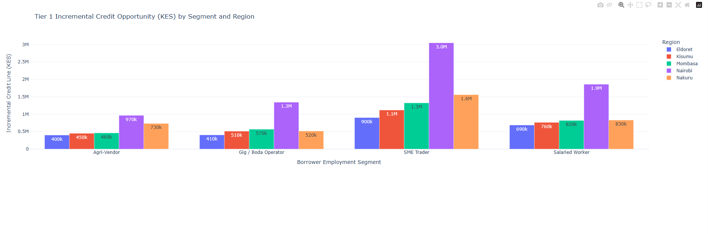

# 📊 Microfinance Loan Portfolio Analytics & Eligibility Tracker

## 📝 Executive Summary
This project simulates a real-world micro-lending environment to analyze credit risk, credit limit utilization, and repayment discipline. Using Python, a synthetic relational database of borrowers and their historical loan transactions was engineered to build a **Borrower Eligibility Matrix**. 

The primary objective is to programmatically identify prime candidates for targeted cross-selling and upselling campaigns based on their historical repayment behavior and current credit limit utilization.

## 🛠️ Technical Stack
* **Data Engineering & Manipulation:** Python (Pandas, NumPy)
* **Synthetic Data Generation:** Faker
* **Data Visualization:** Plotly Express
* **Environment:** Jupyter Notebooks

## 🗄️ Data Architecture
The project is built on a custom-generated star schema designed for both Python analytics and standard BI reporting tools:

* **`dim_borrowers`**: Contains demographic and financial profiles (Income, Employment Segment, Initial Credit Limits, Onboarding Dates).
* **`fact_loans`**: A transactional table recording thousands of individual loan disbursements, interest fees, tenure lengths, and precise repayment statuses (`Repaid Early`, `On-Time`, `Late`, `High Risk`).

## 📈 Key Insights & Visualizations

### 1. Borrower Eligibility Matrix
This scatter plot segments users based on their average days from the due date versus their credit limit utilization. It successfully isolates "Tier 1" prime borrowers who pay on time (negative average days from due date) and actively utilize their limits (near or above the 85% utilization target), categorizing them as ready for a 1.5x limit top-up. The visualization includes interactive hover data displaying granular borrower details, such as employment segment, current credit limit, and specific campaign tiering.


### 2. Tier 1 Incremental Credit Opportunity by Segment and Region
This bar chart projects the potential portfolio growth by offering the targeted incremental credit lines (in KES) strictly to the Tier 1 prime borrowers. It breaks down the monetary opportunity across key employment segments—Agri-Vendor, Gig / Boda Operator, SME Trader, and Salaried Worker—and geographic regions. The analysis reveals that SME Traders in Nairobi represent the highest-value expansion target at 3.0M KES, followed by Salaried Workers in Nairobi at 1.9M KES.



## 🧠 Core Analytical Logic
* **Risk Personas:** Engineered synthetic personas (`Prime`, `Average`, `Late_Risk`) with weighted probabilities to simulate realistic default and late-payment distributions.
* **Dynamic Date Logic:** Implemented forward-rolling date calculations to ensure realistic loan tenures (14 vs. 30 days) and gap days between subsequent loans.
* **Scoring Engine:** Aggregated historical transaction data to score current active borrowers, assigning them to tailored campaign tiers based on continuous on-time repayment streaks.

## 🚀 How to Run Locally
1. Clone this repository.
2. Install the required dependencies:
   ```bash
   pip install pandas numpy plotly faker
   ```
3. Open `Micro_Loan_Analytics.ipynb` in Jupyter Notebook.
4. Run the cells sequentially to generate fresh datasets and render the interactive Plotly charts.